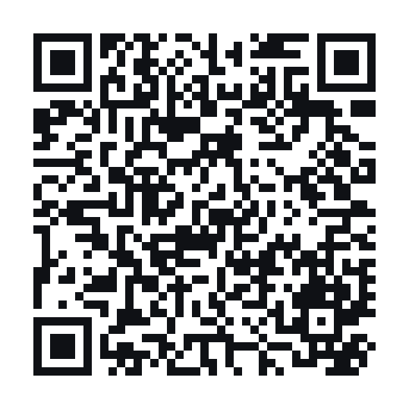

# 🧼 去水印工具 Watermark Remover

一个**纯前端、零依赖**的多功能图片去水印网页工具。所有处理都在浏览器本地完成，**图片不会上传到任何服务器**，断网也能使用，适合处理内部素材。

🌐 **在线使用**：[wmfree.com](https://wmfree.com/)

📱 **手机扫码打开**：

## ✨ 功能特点

集成了多种去水印方式，按需选择：

| 方式 | 原理 | 适用场景 |
|------|------|----------|
| ✨ **智能修复** | 涂抹标记水印 → 算法参考四周像素**还原背景** | 透明 LOGO、文字水印，背景干净/渐变/纯色 |
| ⬚ **矩形修复** | 框选矩形区域自动还原 | 边角的方块台标 |
| 🎯 **仿制图章** | 按住 `Alt` 取样干净区域，涂抹复制覆盖 | 背景复杂（人脸、花纹）的纹理修补 |
| 🟫 **马赛克** | 涂抹处变像素块遮盖 | 只需盖住、不需还原 |
| 💧 **模糊** | 涂抹处柔化遮盖 | 自然遮盖 |
| 🎨 **纯色涂抹** | 选定单色直接覆盖 | 直接盖掉 |

其它：
- 📥 拖拽 / 点击 / **粘贴截图（Ctrl+V）** 三种方式导入
- 🖌️ 画笔大小可调、光标圆圈实时预览
- ↩️ 撤销 / 重做（`Ctrl+Z`）、一键复位原图
- 👁 按住对比修复前后效果
- ⬇️ 导出 PNG

## 🚀 使用方法

访问 [wmfree.com](https://wmfree.com/)，选择、拖入或粘贴图片，编辑后下载 PNG。

独立下载版不再随仓库分发。网站说明与政策见 [常见问题](https://wmfree.com/faq.html)、[关于本站](https://wmfree.com/about.html)、[联系我们](https://wmfree.com/contact.html)、[隐私政策](https://wmfree.com/privacy.html) 和 [使用条款](https://wmfree.com/terms.html)。

## 🔒 隐私说明

本工具是 100% 客户端应用，不含任何后端。你导入的图片只存在于当前浏览器内存中，关闭页面即清除，**全程不会发送到网络**。

图片处理不会上传图片；网页本身使用 Google Analytics 统计访问与功能操作，详情见[隐私政策](https://wmfree.com/privacy.html)。

## 项目更新与AI实践

微信搜索公众号 **「Pamela的AI笔记」** 或扫描下方二维码，获取项目更新、最新AI应用案例和实用教程。

## 🛠️ 技术说明

- 单个 HTML 文件，原生 JavaScript + Canvas，无构建步骤、无第三方依赖。
- 智能修复采用「调和扩散」（边界颜色向内传播 + 多次平滑迭代）算法：背景越平整规则，还原越自然；复杂纹理建议改用仿制图章。

## 📄 许可

MIT License，可自由使用与修改。
